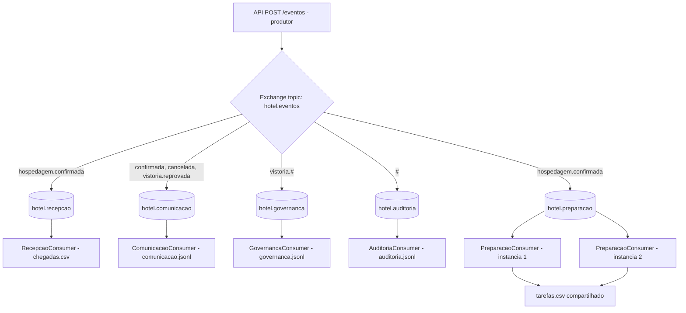

# Arquitetura e decisões técnicas

O projeto usa mensageria orientada a eventos. O produtor publica uma mensagem na exchange `hotel.eventos` (tipo `topic`); o RabbitMQ encaminha cópias para as **filas** compatíveis. Cada consumidor funciona como um processo Java independente (perfil Spring específico). Duas instâncias do mesmo consumidor de preparação competem pelas mensagens **de uma única fila**.

## Diagrama

## Componentes

| Responsabilidade | Perfil Spring | Fila | Efeito verificável |
|---|---|---|---|
| Produtor | `produtor` | — | Publica JSON na exchange com routing key |
| Recepção | `recepcao` | `hotel.recepcao` | `dados/chegadas.csv` |
| Comunicação | `comunicacao` | `hotel.comunicacao` | `dados/comunicacao.jsonl` |
| Governança | `governanca` | `hotel.governanca` | `dados/governanca.jsonl` |
| Auditoria | `auditoria` | `hotel.auditoria` | `dados/auditoria.jsonl` |
| Preparação | `preparacao` (duas instâncias) | `hotel.preparacao` | `dados/tarefas.csv`, incluindo instância que processou |

`RabbitConfig.java` declara uma exchange durável, cinco filas duráveis e seus bindings.

## Por que uma exchange `topic`?

| Exchange | Regra | Consequência neste cenário |
|---|---|---|
| **topic** (escolhida) | Chaves exatas e curingas (`*` = uma palavra; `#` = zero ou mais) | Permite eventos específicos, família `vistoria.#` e auditoria abrangente `#` |
| `direct` | Correspondência exata entre routing key e binding | Exigiria bindings separados para cada novo tipo de vistoria e para a auditoria |
| `fanout` | Publica em todas as filas ligadas, independentemente da routing key | Enviaria eventos irrelevantes a vários setores, exigindo filtragem na aplicação |

## Persistência, ACK e falhas

- Cada setor possui uma fila independente; desligar a comunicação não interrompe a recepção nem a auditoria.
- Filas duráveis e mensagens persistentes permitem que publicações pendentes permaneçam disponíveis após interrupções do consumidor. A durabilidade depende também de o broker preservar seu volume de dados.
- Com `acknowledge-mode=auto`, o Spring envia o ACK quando o método do consumidor termina sem erro. Isso **não** significa confirmação antecipada nem elimina toda possibilidade de reentrega.
- A preparação configura `prefetch=1`, permitindo observar a distribuição entre duas instâncias. O RabbitMQ não promete divisão exatamente igual.
- `tarefas.csv` é compartilhado por duas instâncias locais; o código usa bloqueio exclusivo de arquivo para impedir gravações simultâneas. Essa proteção não equivale a uma transação entre arquivo e RabbitMQ.
- Recepção e preparação evitam duplicidade usando `eventoId` ou `hospedagemId`; governança verifica `eventoId`. A auditoria registra um histórico dos eventos recebidos.
- Para um novo evento `vistoria.agendada`, os padrões de roteamento já selecionam governança e auditoria, mas a API atual rejeita tipos não mapeados. A inclusão exige adaptação da validação/mapeamento do produtor.
- Eventos que não correspondem a regras de um setor não entram na fila daquele setor. A auditoria, ligada ao padrão `#`, recebe toda publicação roteada pela exchange.

## Limite do escopo

Execução local com Docker e múltiplos processos Java; não há interface gráfica, autenticação, serviços externos ou implantação em nuvem, pois não são requisitos obrigatórios. Os registros locais demonstram os efeitos do consumo sem um banco de dados.
